<div align="center">

# HISN · حصن

**حصنٌ يعزّز حماية شبكتك**: a home DNS server that stops phishing and fake websites before they load

Python · scikit-learn · Flask · SQLite · Arabic and English

</div>


Someone at home taps a link in a text message: `alrajhi-bank.com`, "your account is suspended". The
page looks exactly like the bank. HISN never lets it open. The phone gets HISN's own page instead,
which says in Arabic and English that the site impersonates a known organization and what to do now.

HISN sits where every device already asks before opening a site: the network's DNS server. One small
program can protect every phone, laptop and TV at home, with nothing installed on them. It knows the
official domains of Saudi government services and banks, catches names that imitate them, and uses a
machine-learning model for phishing names it has never seen.

> **Status:** complete. Built in ten phases, from the DNS server to the dashboard, plus an optional
> visual check (Phase 11). How the parts fit:
> [docs/architecture.md](docs/architecture.md). A ten-minute demo: [docs/demo.md](docs/demo.md).
> Every screenshot here uses made-up demo data.

**Contents:** [How it works](#how-it-works) · [Why a site gets blocked](#why-a-site-gets-blocked) ·
[The block page](#the-block-page) · [The dashboard](#the-dashboard) · [Results](#results) ·
[Try it](#try-it) · [Use HISN for real](#use-hisn-for-real) · [Full guide](#full-guide)

## How it works

Before a browser opens `alrajhi-bank.com`, the device asks the DNS server for its address. HISN is that
server, so every name passes through it first:

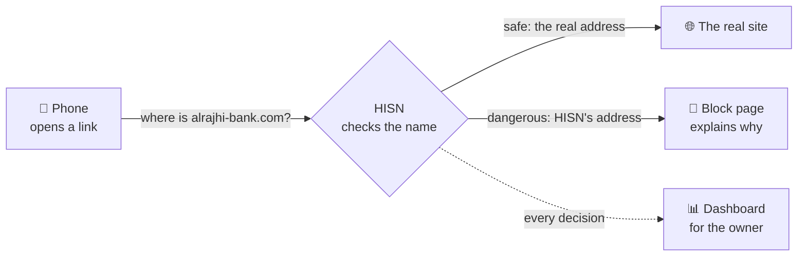

Checking a name takes a few milliseconds, so browsing feels the same. If anything inside HISN breaks,
names are allowed rather than blocked: a fault never takes the home offline.

## Why a site gets blocked

HISN asks a fixed list of questions about every name, in order, and stops at the first answer:

| # | Question | If yes |
| --- | --- | --- |
| 1 | Is it an official domain (`absher.sa`, `alrajhibank.com.sa`, `my.gov.sa`, ...) or a subdomain of one? | Allow |
| 2 | Did the owner unblock it from the dashboard? | Allow |
| 3 | Is it on the list of reported fraud sites? | **Block: reported fraud site** |
| 4 | Does it imitate a known brand on a domain that is not the brand's? | **Block: impersonation** |
| 5 | Does the model think it is a phishing name (at least 90% sure)? | **Block: model decision** |
| 6 | *Optional:* the model is unsure (50% to 90%). Does the site's page look like an official site? | **Block: visual match** |
| 7 | Nothing matched | Allow |

So the block page shows one of these reasons (the example names are illustrations):

| Reason | Example | How HISN knows |
| --- | --- | --- |
| **Reported fraud site** | `absher-sa.com` | It is on the blacklist (`data/lists/blacklist.txt`). |
| **Impersonates a known organization** | `alrajhi-bank.com`, `a1rajhi.com` (digit 1 for l), `abshr.sa` (missing letter), `absher-login.com` | The look-alike rule finds a brand name, a look-alike spelling or swapped letters outside the brand's official domains. |
| **Resembles known fraud names** | a name like `secure-account-update7731.top` | A Random Forest trained on thousands of real phishing and normal names scores the name: long runs of digits, cheap suffixes, words like "secure" and "update". A domain registered days ago counts against it. |
| **Looks like an official site** (optional) | a name like `rajhi-online-services.top` showing a copy of the bank's page | A separate worker opens the page once in a locked-down browser and compares its screenshot with screenshots of the official sites ([Visual check](#visual-check-optional)). |
| **Classified as unsafe** | any older block | The site was blocked, but the log that said why has since been deleted. |

| Reported fraud site | Impersonation |
| --- | --- |
| 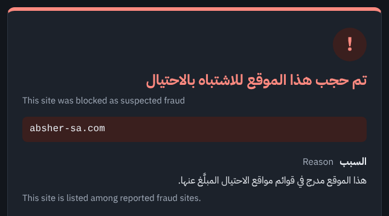 | 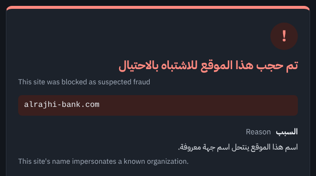 |
| **Model decision** | **Older block, reason deleted** |
| 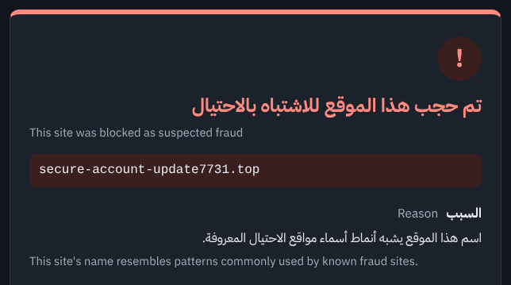 | 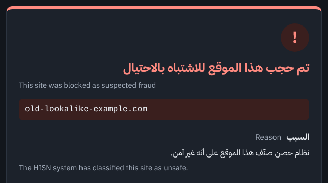 |

Two more things HISN does quietly:

- **Stops DNS-over-HTTPS bypass.** Browsers can send their lookups to Google or Cloudflare over HTTPS
  and skip the home DNS. HISN answers those services' names with "no such name", so browsers fall back
  to HISN. The dashboard counts these separately; they are not threats.
- **Matches on whole labels only.** `login.absher.sa` is official, but `absher.sa.fake-login.com` is
  not: a fake site cannot pass by containing an official name.

## The block page

Every blocked site leads here, on any device:

- the blocked name and the reason, in Arabic and English;
- what to do: do not enter a password or card details, open the service from its official app, and
  what to do if details were already entered;
- a **Back to safety** button.

The page runs no script and never reads what a phishing form sends to it. It works for links typed or
opened as `http://`; an `https://` link ends in the browser's "site can't be reached" error instead.
Either way the fake site never loads (see [docs/https_block_page.md](docs/https_block_page.md)).


## The dashboard

One owner account, created on the HISN computer itself, signs in from any device at home. The
dashboard refreshes every 15 seconds and covers the last 30 days. Here is each part.

### Alert banner

Lists what was blocked since the owner last looked, until the owner presses OK.

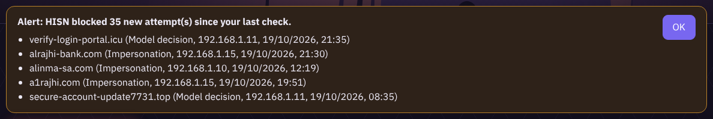

### Tiles

Threats blocked in the last 30 days, blocked and allowed today, DoH bypass attempts stopped, and devices on the network.

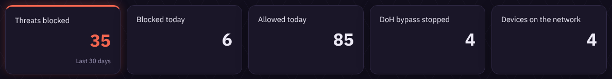

### Charts

Requests per day (allowed and blocked), and blocks by reason.

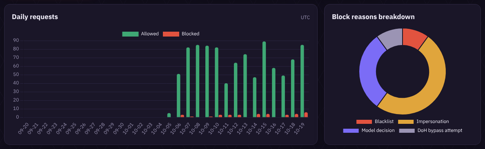

### Lists

Latest blocks and the sites blocked more than once, each with its reason and an Unblock button, then the activity of each device.

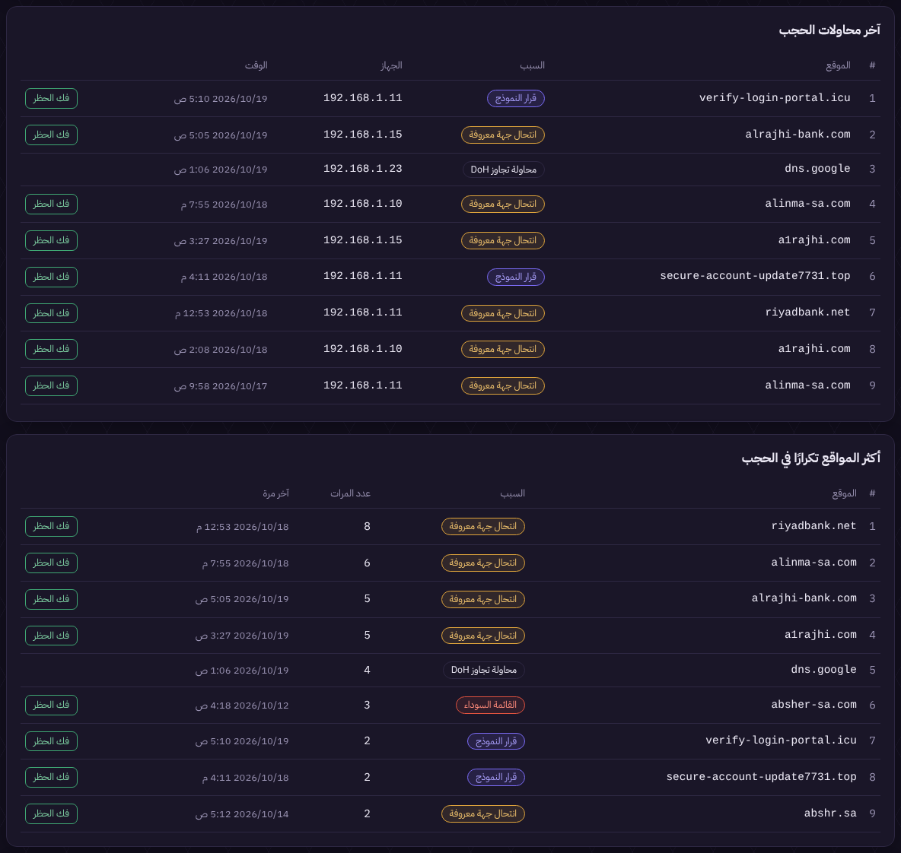

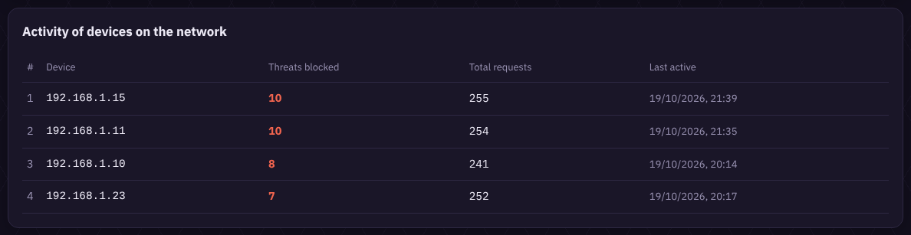

### Unblock and Block again

Unblock a site in one click (it takes effect within 2 seconds, no restart). It then appears here, with a Block again button.

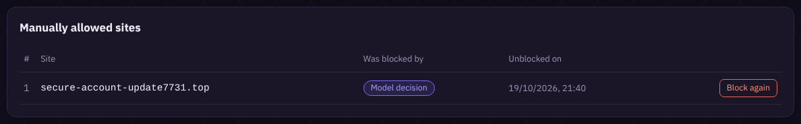

### Arabic or English, dark or light, laptop or phone

| Arabic | Light mode | Phone | Sign-in |
| --- | --- | --- | --- |
| 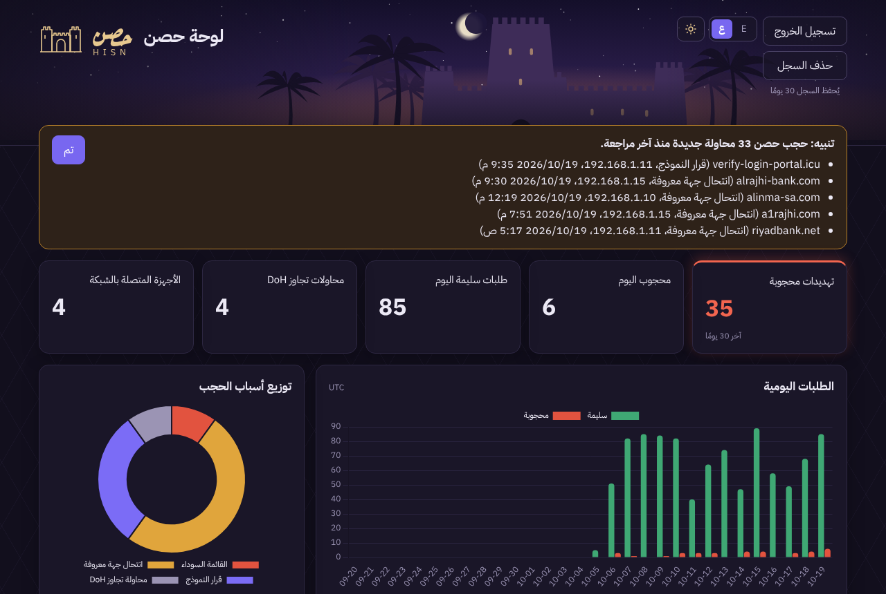 |  |  |  |

## Results

From `python -m ml.evaluate` on the project owner's computer (dataset: 12,463 malicious and 200,000
benign names; test split: the newest 2,493 malicious names and 40,000 benign names, never used in
training). **Every figure depends on unreviewed labels and generated look-alikes; read
[docs/limitations.md](docs/limitations.md) first.**

| What was measured | Result |
| --- | --- |
| Model on new phishing names, name only, threshold 0.90 | precision 0.953, recall 0.254 (634 of 2,493 caught, 31 of 40,000 benign blocked) |
| Same, whole precision-recall curve | average precision 0.510 |
| Model on look-alikes of brands it never saw (alinma, nafath) | 151 of 213 caught (70.9%) |
| Look-alike rule on generated look-alikes of every brand | 639 of 639 caught (100%) |
| Look-alike rule on benign test names | 1 of 40,000 wrongly flagged (`alinea.dk`, one letter from `alinma`) |
| Model on test names with a known domain age | recall 0.419 with the age vs 0.233 on the name alone (precision 0.994 vs 1.000; 377 malicious names with a known age) |

Other thresholds on the same test split:

| Threshold | Precision | Recall | Benign blocked (of 40,000) |
| --- | --- | --- | --- |
| 0.70 | 0.740 | 0.357 | 312 |
| 0.80 | 0.873 | 0.305 | 111 |
| 0.90 (default) | 0.953 | 0.254 | 31 |
| 0.95 | 0.992 | 0.194 | 4 |

What this means:

- **Look-alikes of Saudi brands** are HISN's main target, and the rule catches all generated ones
  while flagging 1 benign name in 40,000. The rule and the generator were written together, so that 100%
  is a sanity check; the false positives are the meaningful number. Real attacks seen in the wild were
  not available to test (the phishing feed used had no reports for these brands when checked).
- **Generic phishing names** are hard to spot from the name alone: at 0.90 the model blocks about one
  in four, and almost never a benign name. The threshold favours not breaking legitimate sites;
  the table shows the cost of moving it.
- **Domain age** helps: phishing domains are young (median 24 days, 51% under 30 days) and benign ones
  old (median 5,433 days). Where the age is known, recall almost doubles. It is looked up in the
  background, so the first answer for a new name uses the name alone.
- **Omission** and **transposition** look-alikes (a missing or swapped letter, such as `ainma.sa`) are the
  model's weak spots (10 of 32 and 13 of 32 caught); the rule catches them. After this retraining on
  more feed data the held-out look-alike recall went down (78.9% to 70.9%, on only 213 names), while
  the name-only numbers went up: the model trades one for the other, and the rule covers the gap.

## Try it

Needs Python 3.11 or newer. On a laptop, with test ports and no admin rights:

```bash
python -m venv .venv
.venv\Scripts\activate            # macOS/Linux: source .venv/bin/activate
pip install -r requirements-dev.txt
python -m pytest
python -m dns_server.server
```

In a second terminal, ask HISN about a name (it answers `127.0.0.1`, the block page, for a blocked one):

```bash
python -c "import sys; from dnslib import DNSRecord; print(DNSRecord.parse(DNSRecord.question(sys.argv[1]).send('127.0.0.1', 5353, timeout=5)))" alrajhi-bank.com
```

The lists and the look-alike rule work straight away. The model needs data and training first
([Prepare the data](#prepare-the-data)); without it HISN runs on the lists and the rule. To protect a
real browser or the whole home, see [Use HISN for real](#use-hisn-for-real).

---

## Full guide

Everything below is the reference: each part, its settings and how to check it.

## Setup

```bash
python3 -m venv .venv
source .venv/bin/activate          # Windows: .venv\Scripts\activate
pip install -r requirements-dev.txt
cp .env.example .env               # optional, defaults are safe for development
```

## Check the setup

```bash
python -c "from config import settings; print(settings.dns_host, settings.dns_port)"
```

Expected output: `127.0.0.1 5353`.

## Run the DNS server (development)

```bash
python -m dns_server.server
```

It listens on `127.0.0.1:5353` (UDP and TCP). Port 5353 needs no admin rights; port 53 is only for real use,
see [Use HISN for real](#use-hisn-for-real).
Stop it with `Ctrl+C`. If another program already uses port 5353, set `HISN_DNS_PORT` to a free port in `.env`.

Query it from a second terminal (works on every OS):

```bash
python -c "import sys; from dnslib import DNSRecord; print(DNSRecord.parse(DNSRecord.question(sys.argv[1]).send('127.0.0.1', 5353, timeout=5)))" absher-sa.com
```

Replace the last word with any domain. A blocked domain answers `127.0.0.1` (the block page address).
`nslookup -port=...` is not reliable on Windows (it may ignore the port), so use the command above.
On Linux and macOS `dig @127.0.0.1 -p 5353 absher-sa.com` also works.

Blocked domains get the block page address (`HISN_BLOCK_PAGE_IP`). Everything else is forwarded to the upstream DNS.
Edit `data/lists/whitelist.txt` and `data/lists/blacklist.txt`, then restart the server.

### How HISN decides whether to block a site

For every name a device asks about, HISN goes through these steps in order. **The first step that
gives an answer wins**, and the rest are skipped:

1. **DoH servers** (`dns.google` and similar): answered "not found" so browsers fall back to HISN's DNS
   ([DNS-over-HTTPS blocking](#dns-over-https-blocking)).
2. **Whitelist:** official sites, always allowed.
3. **Sites the owner unblocked** in the dashboard: allowed.
4. **Blacklist:** known fraud sites, always blocked.
5. **Verdict cache:** if HISN already decided about this name in the last hour, reuse that answer.
6. **Look-alike rule:** a name that imitates a brand in `brands.txt` is blocked on its own.
7. **Model:** blocked if its probability is at least `HISN_MODEL_THRESHOLD` (default 0.90), otherwise
   allowed. The domain age is one of its inputs when it is already known ([Domain age](#domain-age)).
8. **Visual check** (optional, only when it is on): a name the model scored from `HISN_VISUAL_MIN_SCORE`
   (default 0.50) up to the threshold is blocked once its page was found to look like an official site
   ([Visual check](#visual-check-optional)).
9. **Default:** allow.

Only the look-alike rule and the model (steps 6 and 7) store their verdict in the cache. `HISN_LOOKALIKE_BLOCK` lists the look-alike
techniques that block on their own (default `brand_name,hyphenation,homoglyph,typo`; leave it empty to
turn the rule off). `contains` (the brand inside a longer word) is left to the model by default, because
a bank's own sister companies look like that.

The model is loaded once at startup from `HISN_MODEL_PATH`. If the file is missing or broken, the server
logs a warning and runs without it; if the model fails on a name, that name is allowed and the error is
logged. After retraining, restart the server. The first query for a new name takes some milliseconds
longer (feature extraction and the forest); repeats come from the cache.

The reason of every decision (`whitelist`, `owner`, `blacklist`, `cache`, `lookalike`, `model`, `visual`, `default`) is in
the log, so you can see why a name was blocked:

```bash
python -c "from storage.db import Database; [print(r.verdict, r.reason, r.domain) for r in Database('data/hisn.db').recent_requests(10)]"
```

### Domain age

Newly registered domains are riskier. When the model scores a name, the server also asks for the
registration date of its registered domain (`example.com` for `login.example.com`) from RDAP, the
JSON successor of WHOIS that registries serve over HTTPS. The lookup runs in background threads and
**never delays the DNS answer**:

- the first query for a domain is scored on the name alone, and that verdict is not cached;
- once the lookup has finished (usually within a second), the next query is scored with the age and
  that verdict is cached as before;
- a missing age (no RDAP server for the suffix, timeout, error, deleted domain) means "unknown",
  which never blocks on its own.

Registration dates are kept in memory for `HISN_DOMAIN_AGE_CACHE_TTL` seconds (default 7 days);
"no data" answers are retried after a day, failures after an hour. Hosts on shared platforms
(`x.netlify.app`, `x.duckdns.org`) are never looked up and always have an unknown age. Lookups send the registered domain
(never the full host) to the registry of its suffix. Set `HISN_DOMAIN_AGE_LOOKUP=false` to turn them
off; the model then scores names only.

### DNS-over-HTTPS blocking

Browsers that use DNS-over-HTTPS (DoH) send their lookups straight to a public resolver over HTTPS,
so HISN would never see them. Before using DoH they look up the DoH server's own name through the
normal DNS, and HISN answers that with NXDOMAIN ("no such name"). Most browsers then fall back to
the network's DNS, which is HISN. This step comes before the whitelist and the blacklist.

- The DoH servers are listed in `data/lists/doh_hosts.txt` (Google, Cloudflare, Quad9, OpenDNS,
  NextDNS and others). Subdomains match too, on label boundaries. Edit the file and restart.
- `use-application-dns.net` is always answered NXDOMAIN: it is Firefox's documented signal that the
  network filters DNS on purpose, and Firefox then keeps its automatic DoH off.
- `mask.icloud.com` and `mask-h2.icloud.com` are listed so Apple devices turn iCloud Private Relay
  off on this network (they show the user a notice).
- These answers are logged with the reason `doh`. Set `HISN_DOH_BLOCK=false` to turn it off.

Check it (each should print `status: NXDOMAIN`):

```bash
python -c "import sys; from dnslib import DNSRecord; print(DNSRecord.parse(DNSRecord.question(sys.argv[1]).send('127.0.0.1', 5353, timeout=5)))" dns.google
```

A DoH server set up by its IP address, a browser where the user forced DoH on, and DNS-over-TLS
(port 853) are not stopped by this; see [docs/limitations.md](docs/limitations.md).

### Visual check (optional)

Phishing kits copy the official page so the victim trusts it. The visual check catches a copy that the
model was unsure about: a name the model scores from `HISN_VISUAL_MIN_SCORE` (default 0.50) up to
`HISN_MODEL_THRESHOLD` is queued, a separate worker opens its home page once in a headless browser,
and if the screenshot looks like one of the official reference screenshots, the name is blocked from
then on with the reason **visual match**. It is off by default because it makes the HISN computer
open suspicious sites.

How it decides: each screenshot becomes a 64-bit perceptual hash (pHash: greyscale, shrunk to
32 x 32, the lowest frequencies of a DCT). A copy of a page lands within a few bits of the original;
unrelated pages differ in about 32. Home pages have a rotating banner that changes the whole-page hash,
so the top strip (logo and menu, 160 pixels) gets its own hash, and a page matches when either hash is
within `HISN_VISUAL_MAX_DISTANCE` (default 10) of a reference. A strip that is blank is never compared.

Like the domain age, it **never delays the DNS answer**: the first visit is answered by the model, the
check runs in the background, and the result protects the next visit and every other device. The DNS
server never opens a browser; it only writes the name into the `visual_checks` table, and the worker
writes the result back.

The browser is treated as hostile ground (`ml/visual/capture.py`, `ml/visual/ssrf_guard.py`):

- **the browser never connects to anything itself.** Every request it makes (the page, its images and
  styles, on any host, and every redirect) is fetched by HISN's guard, which resolves the name through
  the upstream DNS server, allows **public addresses only** and connects to exactly the address it
  checked. A page can never make HISN open the router or another device at home (SSRF);
- inside the browser every name and IP address is "not found", as a second wall; only GET requests are
  fetched, with no cookies;
- no proxy, no WebRTC, no downloads, no service workers, a fresh empty profile for every page, and the
  screenshot is never saved, only its hash;
- Chromium's sandbox is on, and the worker refuses to run as root or as a Windows administrator.

Set it up once (in a normal window, **not** as administrator):

```bash
python -m playwright install chromium
```

```bash
python -m ml.visual.reference_hashes
```

The second command tries to photograph the official pages listed in `data/references/references.txt`
(only whitelisted domains are accepted) three times each, a few seconds apart, in exactly the same
browser as the checks, and writes `data/references/hashes.json`. **Many official sites refuse automatic
browsers** (a captcha, "The requested URL was rejected"); the command skips those pages and never keeps
an error page as a reference. Login pages are what kits
copy most: for every brand that was skipped, open its login page in your own browser (maximised, light
mode), take a screenshot of the page without the address bar (`Win + Shift + S`), save it, and add it:
`python -m ml.visual.reference_hashes --add alrajhi login.png`. Screenshots and hashes stay on your
computer (`.gitignore`).

Then set `HISN_VISUAL_CHECK=true` in `.env`, restart the DNS server, and start the worker in its own
normal window:

```bash
python -m ml.visual.worker
```

Check one name by hand (nothing goes to the database): `python -m ml.visual.worker --check example.com`.
Add `--save shot.png` to keep the screenshot and print the distance to the closest reference of each
brand, to see what the check saw. An
official page itself (`--check www.alrajhibank.com.sa`) should come out as `match`: if it does not, its
page changes too much between visits to be a good reference, and a screenshot of its login page
(`--add`) works better. If the
worker is not running, names stay queued and the model's verdict stands. Results are trusted for
`HISN_VISUAL_TTL` seconds (default 7 days) and are deleted with the logs.

Measure it on its own with screenshots of ordinary sites (never the official ones):

```bash
python -m ml.visual.capture --out data/visual_eval/negatives google.com wikipedia.org github.com
```

```bash
python -m ml.visual.evaluate --negatives data/visual_eval/negatives
```

It prints precision and recall at the configured distance and for other distances. Without real
impersonation screenshots (`--positives`), it uses synthetic copies of the references (shifted,
resized, re-compressed, with a banner), which is the best case; see
[docs/limitations.md](docs/limitations.md#visual-check-phase-11).

## Block page

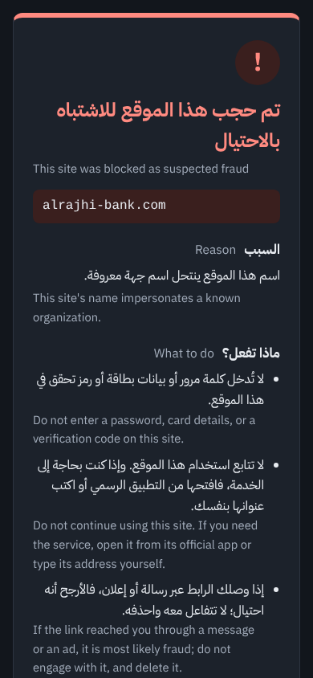

A blocked name resolves to `HISN_BLOCK_PAGE_IP`, so the browser lands on the block page instead of
the real site. Run it in a second terminal, next to the DNS server:

```bash
python -m web.block_page.app
```

It listens on `HISN_BLOCK_PAGE_IP` port `HISN_BLOCK_PAGE_PORT` (default `127.0.0.1:80`). Every path
shows the same page, in Arabic and English: "This site was blocked as suspected fraud", the blocked
name, a simple reason, advice, and a "Back to safety" button (goes to `HISN_BLOCK_PAGE_SAFE_URL`,
default `https://www.google.com/`).

The reason comes from the decision log (`data/hisn.db`): reported fraud site (blacklist), impersonates a
known organization (look-alike rule), or resembles known fraud names (model). A name that is not
in the log (purged or deleted) gets a general "classified as unsafe" line.

Check it with a browser at `http://127.0.0.1/` (no name is shown when the page is opened by its
address), or pretend to be a blocked site:

```bash
curl -H "Host: absher-sa.com" http://127.0.0.1/login
```

On Windows PowerShell use `curl.exe` (plain `curl` is a different command there). If port 80 is
taken, set `HISN_BLOCK_PAGE_PORT` to a free port such as 8081; real browsers only use port 80, so that
is for testing.

The Arabic and English text uses IBM Plex Sans Arabic, bundled in `web/block_page/static/fonts/`
(SIL Open Font License, `OFL.txt` next to it), so the page needs no internet.

The page runs no script, is never framed or cached, escapes the host name, and never reads what a
phishing form posts to it. It serves plain HTTP only: an `https://` link shows a browser error instead
of the page. The plan for that is in [docs/https_block_page.md](docs/https_block_page.md).

<br clear="right">

## Dashboard

The dashboard shows what HISN blocked on this network: threats blocked over the last 30 days and today,
requests per day and the breakdown of block reasons (Chart.js charts), the latest blocks, the sites
blocked more than once, the activity of each device and DoH bypass attempts stopped. When something new
was blocked since the owner last pressed "OK", an alert banner lists it (the page refreshes every 15
seconds and the browser tab shows the count).

Everything comes from the decision log of this HISN (`data/hisn.db`, never committed), so a new
installation starts empty and fills only with the queries of the network it serves. Every count and
list covers the same period, the retention period of the log (`HISN_LOG_RETENTION_DAYS`, 30 days), so
the threat tile and the device table always agree and an entry leaves the dashboard when the log forgets
it. The tables list every row, numbered, and a long table scrolls inside its card. DoH lookups are listed with the label "DoH bypass attempt" but are not counted as threats. The
chart and the "today" tiles use UTC days; the tables show times in the viewer's own time zone. The reason chart always lists every reason (blacklist, impersonation, model decision,
DoH), even at zero.

There is one account, the admin, shared by the people who manage the home network; each device signs
in and out on its own. The pages are in Arabic or English (the ع|E button at the top), in dark or light
mode (the ☾/☀ button next to it); both choices are remembered in the browser.

1. Start the dashboard in another terminal (next to the DNS server and the block page):

   ```bash
   python -m api.app
   ```

2. The first time, open `http://127.0.0.1:8080/` **on the HISN computer itself** and create the account
   (username, then a password of at least 12 characters, twice). For safety this works only from that
   computer and only once, so nobody else on the network can claim the account first.

3. From then on, open the dashboard from any device on the home network and sign in with the username and
   password (the username ignores upper/lower case).
   It works on a phone or a laptop.

Forgotten password: run this on the HISN computer, then restart the dashboard:

```bash
python -m api.set_password
```

Security: it refuses to start on an address that is not loopback or private (`HISN_API_HOST`, default
`127.0.0.1`), and only `HISN_ALLOWED_NETWORKS` clients get an answer. Only a salted scrypt hash of the
password is kept, in the database. Signing in returns a random session token (8 hours, kept in memory,
so a restart signs everyone out); every other `/api/` call needs `Authorization: Bearer <session token>`.
The page keeps the token in the browser tab only (no cookie, so no CSRF) and never stores the password.
Wrong sign-ins are limited to 10 per 10 minutes per client (the answer never says whether the
username or the password was wrong), and all requests to 240 per minute. Domains
are shown with `textContent` only (no HTML), and a strict Content Security Policy allows no inline
script. "Delete logs" wipes the whole log, like `python -m storage.db delete-all --yes`; the account and
the unblocked sites stay.

**Unblocking a site.** If HISN blocked a site by mistake, press "فك الحظر" (Unblock) next to it in
"Latest blocks" or "Most frequently blocked sites". The site then leaves both lists and moves to
"Manually allowed sites". It is then allowed for every device, even if it is on the blacklist or the rule or
the model would block it, and its subdomains too. The DNS server reads the change from the database
within about 2 seconds, with no restart; devices may keep the block for up to 30 seconds more (the
block answer's TTL) and browsers a little longer. The "Manually allowed sites" card lists these sites with the
reason they had been blocked, and "إعادة الحجب" (Block again) puts the normal checks back. The list is a
setting, kept when logs are purged or deleted; each unblock and re-block is also logged. DNS-over-HTTPS
hosts cannot be unblocked this way.

API (JSON): `GET /api/setup` says whether the account exists; `POST /api/setup` with
`{"username", "password", "confirm"}` creates it (first start, HISN computer only); `POST /api/login` with
`{"username": "...", "password": "..."}` returns `{"token", "expires_in"}`. With the token: `GET /api/me`,
`GET /api/stats`, `/api/blocked`, `/api/devices`, `/api/recent?after=<id>`, `/api/allowed`,
`POST /api/allowed` and `POST /api/allowed/delete` with `{"domain": "..."}`, `POST /api/logout`,
`POST /api/logs/delete` with `{"confirm": "delete"}`.

Chart.js 4.4.7 is bundled in `web/dashboard/vendor/` (MIT license next to it) and the logo font Aref Ruqaa
in `web/dashboard/fonts/` (SIL Open Font License, `OFL.txt` next to it), so the dashboard needs no internet.
The header art (`web/dashboard/banner.svg`) is an original drawing made for HISN.

## Use HISN for real

Everything above runs on test ports, so the browser never asks HISN: a device sends its DNS lookups to
port 53 of the DNS server it was given (usually the router). To block sites while browsing, choose one
of two set-ups. Both need the DNS server on port 53 and the block page on port 80, which needs admin
rights (Windows: PowerShell "Run as administrator"; Linux: `sudo .venv/bin/python -m ...`).

### Option A: one computer

Only the computer that runs HISN is protected. Good for trying it out and for a demo.

1. In `.env` set `HISN_DNS_PORT=53` (keep `HISN_DNS_HOST=127.0.0.1` and `HISN_BLOCK_PAGE_IP=127.0.0.1`).
2. As admin, start the DNS server and, in a second window, the block page:

   ```bash
   python -m dns_server.server
   ```

   ```bash
   python -m web.block_page.app
   ```

3. Point this computer's DNS at HISN.
   - Windows 11: Settings > Network & internet > Wi-Fi or Ethernet > DNS server assignment > Edit >
     Manual. Turn IPv4 on with preferred DNS `127.0.0.1` and leave IPv6 off.
   - macOS: System Settings > Network > (connection) > Details > DNS, replace the list with `127.0.0.1`.
4. Clear the old answers, then restart the browser:

   ```bash
   ipconfig /flushdns
   ```

   (macOS: `sudo dscacheutil -flushcache; sudo killall -HUP mDNSResponder`.)
5. In the browser settings, turn off "Use secure DNS" if it is set to a fixed provider.
6. Open `http://absher-sa.com`: the HISN block page appears. An `https://` link shows the browser's
   "site can't be reached" error instead, which still means the site was blocked.

To stop, set the computer's DNS back to automatic **before** stopping HISN, or it has no internet.

### Option B: the whole home network

Every device that joins the Wi-Fi uses HISN, with nothing to set on the devices. HISN should run on a
computer that is always on (for example a Raspberry Pi): if it is off, the whole home has no internet.

1. In the router, give the HISN computer a fixed address (DHCP reservation), for example `192.168.1.50`.
2. In `.env` on that computer, use that address so other devices can reach HISN:

   ```ini
   HISN_DNS_HOST=192.168.1.50
   HISN_DNS_PORT=53
   HISN_BLOCK_PAGE_IP=192.168.1.50
   ```

   `HISN_ALLOWED_NETWORKS` already includes the usual home ranges; only these answer.
3. Allow incoming UDP and TCP port 53 and TCP port 80 on the private network. On Windows, choose
   "Private networks" when the firewall asks the first time HISN starts.
4. Start the DNS server and the block page as in option A (as admin).
5. In the router's LAN / DHCP settings, set the primary DNS server to `192.168.1.50` and leave the
   secondary DNS empty: devices use either one, so a public secondary lets them skip HISN. If the
   router also hands out an IPv6 DNS server, turn that off as well.
6. Reconnect the devices (or restart the Wi-Fi) so they get the new DNS server.

Some internet-provider routers do not allow changing the DNS server; then this option needs a
different router or HISN acting as the DHCP server (not built). A device using a VPN, or Android
"Private DNS" set to a provider's hostname, can still skip HISN; see [docs/limitations.md](docs/limitations.md).
The dashboard stays on `127.0.0.1:8080` (the HISN computer only) unless `HISN_API_HOST` is changed.

## Logs and privacy

Every decision is stored in a local SQLite file (`data/hisn.db`, never committed): time, domain,
verdict, reason and the client address. Nothing else (no URLs, no answers). Invalid queries are not logged.

- Entries older than `HISN_LOG_RETENTION_DAYS` (default 30) are deleted at startup and every hour.
- Delete old entries now: `python -m storage.db purge`
- Delete everything: `python -m storage.db delete-all --yes`

Daily allow/block totals contain no domains or devices, so they are kept when old entries are purged
and removed only by `delete-all`.

With the visual check on, the names it queued and their results (`visual_checks`) follow the same
retention and are removed by `delete-all` too. Screenshots are never saved; only official reference
screenshots are kept, in `data/references/`.

Verdicts of the look-alike rule and the model are cached in memory for `HISN_VERDICT_CACHE_TTL` seconds
(default one hour, at most 10,000 names). The cache is checked after the whitelist and blacklist, so
editing a list always wins over a cached verdict.

## Prepare the data

The model learns from public feeds. They are third-party data, so they stay in `data/raw/` and
`data/processed/`, which git ignores.

**1. Benign names (Tranco).** Download `https://tranco-list.eu/top-1m-incl-subdomains.csv.zip` (permanent link, no account)
and save it as `data/raw/tranco.csv.zip`. The subdomain version matches real DNS traffic.

**2. Phishing reports with dates (PhishStats).** Free, read access needs no account:

```bash
python -m ml.fetch_phishstats
```

Without a key the API allows 50 requests a day per IP; one request returns 100 reports, so a run gives about 4,500 reports
(roughly two weeks of data). Run it again on another day: it continues further back in time from where it stopped, and saves
only `id, url, first_seen, score`. A free key raises the limit; if you have one, set the environment variable
`PHISHSTATS_API_KEY` (never put it in a file inside the project). The labels are automatic (a `score` from the site, no human review).

Other sources work too if you save them in `data/raw/` with a name that starts with `phishtank` (PhishTank CSV) or pass
them with `--malicious` (for example URLhaus, which is malware rather than phishing and mostly uses bare IP addresses).

**3. Build the dataset:**

```bash
python -m ml.prepare_data
```

It writes `data/processed/dataset.csv` and prints a cleaning report. On purpose it: skips reports with a score below 5
(`--min-score`), drops IP-address hosts, duplicates and overlap between the two classes, keeps at most 50 hosts per owner or
platform (`--max-per-key`, so one free-hosting service cannot become the whole malicious set), samples the benign list at random
(200,000 by default, `--benign-limit`), and splits by time: the **newest** malicious domains form the test set, and hosts of one
registered domain never end up on both sides. Benign names have no date, so they are split at random with the same ratio.
Read the "Dataset" lines in the output: if the two classes differ a lot on something unrelated to phishing, the model could
learn the data source instead.

PhishStats leaves the `score` empty for most reports (about 80% in our downloads), and the few scored ones are mostly
IP-address URLs, which a DNS filter never sees. Without `--keep-unscored` almost nothing usable is left. With it, reports without
a score are kept (reports with a low score are still dropped). **Their labels were never checked by anyone**; Tranco overlap
removal and the per-owner limit remove most legitimate sites, but some noise remains. This limitation must be stated with any
accuracy figure.

```bash
python -m ml.prepare_data --keep-unscored
```

`ml/features.py` turns a domain into numbers (length, hyphens, digits, subdomain depth, keywords, entropy, TLD, brand similarity,
government impersonation, and the look-alike rule's verdict). It needs no network and takes about half a millisecond per name
with the shipped brand list (more brands make it slower).

Brands in `data/lists/brands.txt` need their official domain in `data/lists/whitelist.txt`, otherwise the real site looks like
an impersonation. Add them together, and only after checking the domain on the organisation's own pages.

## Train and evaluate the model

Phishing feeds are mostly random-looking names, so they teach the model nothing about names that
imitate Saudi brands (`absher-sa.com`, `abhser.com`). Two additions cover that:

- `ml/typosquat.py` generates look-alikes of every brand in `brands.txt` (missing letter, swapped
  letters, look-alike letters and digits including punycode, hyphens, brand plus a word, another
  suffix). Every brand gets the same number of names per technique, so rare tricks (swaps, hyphens)
  weigh as much as common ones. Training adds them as malicious examples, except for the brands held
  out for evaluation.
- `ml/lookalike.py` is a fixed rule that flags a name that looks like a brand but is not on its
  official domain. It needs no training. Its verdict is also a model feature, so the model handles
  swapped letters and hyphens. The server will use it from Phase 5.

Train (needs `data/processed/dataset.csv` from Phase 3):

```bash
python -m ml.train
```

It writes `ml/models/hisn_rf.joblib` (never committed). Only load model files you trained yourself.

Evaluate:

```bash
python -m ml.evaluate
```

It prints separate results: precision, recall and the confusion matrix on the newest phishing
names (the temporal test split, scored on the name alone), the model's recall on look-alikes of held-out brands, by brand and
by technique, and the rule's recall plus how many benign test names it wrongly flags. Accuracy is not
shown: with about 1 malicious name per 23 benign ones it says nothing. `--threshold 0.6` tries another
blocking threshold (default `HISN_MODEL_THRESHOLD`).

For a demo, `python -m ml.demo_names` prints new phishing names from the test split that only the model
blocks (no list or rule covers them) and benign names it allows; see [docs/demo.md](docs/demo.md).

To also test a trick the model never saw, hold a technique out of training:

```bash
python -m ml.train --holdout-technique transposition
```

### Domain ages for training

The model can only learn from the age if some training names have one. Look them up once (no key
needed, about one second per domain on purpose, so the registries are not flooded):

```bash
python -m ml.fetch_domain_age --max-lookups 300
```

It picks registered domains from `dataset.csv` at random, half malicious and half benign, and appends
the answers to `data/processed/domain_age.csv` (never committed). Run it again to add more; domains
already answered are skipped. Failed lookups are marked `failed` and skipped too; add `--retry-failed`
to try them again. Hosts on shared platforms (`x.netlify.app`, `x.duckdns.org`, `pub-….r2.dev`) are never
looked up, because the registry only knows the platform. Then retrain and evaluate:

```bash
python -m ml.train
python -m ml.evaluate
```

`ml.train` uses the file when it exists. A malicious name's age is taken on the day it was reported,
a benign name's on the day it was checked. The age is **not** a forest feature: only a small sample of
names has one, and a mostly empty column teaches the forest the wrong thing. Instead the forest judges
the name alone, and an **age table** (`ml/age_table.py`) learned from the train rows with an age moves
its probability: for each age range (under 7 days, 7-30 days, ... over 10 years) it stores how much more
often that range is malicious than benign, capped at 10x either way. An unknown age changes nothing,
and the cap means a brand-new domain with a clean-looking name is still allowed. `ml.train` prints
the table; `ml.evaluate` adds a fourth result: the age of each class, the table, and the test names
with a known age scored with and without it. Without the file (or with fewer than 30 aged train
rows per class) there is no table and the model scores names only.

The model file format changed in Phase 6, so an older model is refused at startup and the server
runs without a model until you retrain.

**Every number depends on labels nobody reviewed and on generated look-alikes.** Read
[docs/limitations.md](docs/limitations.md) before quoting one. A larger brand list is proposed in
[docs/brand_list_proposal.md](docs/brand_list_proposal.md); its domains must be confirmed first.

## Run the tests

```bash
python -m pytest
```

## Security notes

- Never commit `.env`, certificates, datasets or databases (see `.gitignore`).
- Run `pip-audit -r requirements.txt` before every release.
