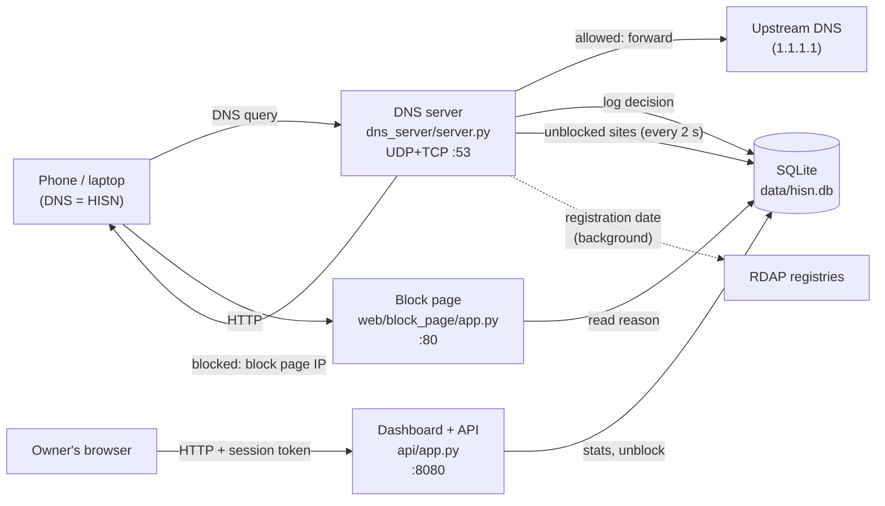
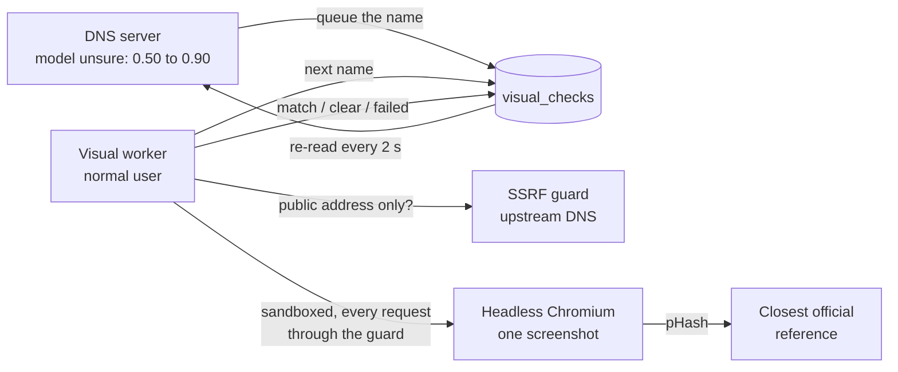
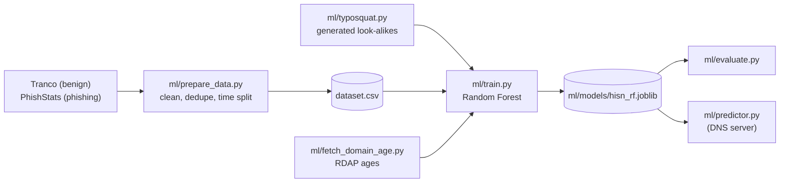

# Architecture

HISN is the DNS server of a home network. Every device asks it for the address of each site it
opens; HISN answers dangerous names with the address of its own block page instead of the real one.
It runs as three small programs on one computer (a laptop or a Raspberry Pi), sharing one SQLite file.

| Program | Command | Listens on | Job |
| --- | --- | --- | --- |
| DNS server | `python -m dns_server.server` | `HISN_DNS_HOST:HISN_DNS_PORT` (5353 for development, 53 for real use), UDP and TCP | Decide every name, answer it, log it |
| Block page | `python -m web.block_page.app` | `HISN_BLOCK_PAGE_IP:HISN_BLOCK_PAGE_PORT` (80) | Explain why a site was blocked |
| Dashboard | `python -m api.app` | `HISN_API_HOST:HISN_API_PORT` (127.0.0.1:8080) | Show blocks, devices and alerts; unblock sites |

Training (`ml/`) runs separately, offline, and produces one model file that the DNS server loads at
startup.

## One query, step by step

`dns_server/server.py` (`HisnResolver`) handles each query:

1. **Client check.** A client outside `HISN_ALLOWED_NETWORKS` gets no answer at all, so HISN can
   never be used as an open resolver or for reflection attacks.
2. **Packet check.** Only standard queries with one question are answered (`NOTIMP` / `FORMERR`
   otherwise); responses sent to the server are ignored.
3. **Name validation** (`dns_server/domain.py`). The name is normalized (lowercase, trailing dot
   removed, IDN to punycode) and checked (length, label rules, characters). An invalid name gets
   `REFUSED` and is not logged.
4. **DoH check** (`dns_server/doh_blocker.py`). DNS-over-HTTPS servers get `NXDOMAIN`, so browsers
   fall back to HISN instead of going around it.
5. **Decision** (`dns_server/decision.py`, below).
6. **Log** (`storage/db.py`): time, domain, verdict, reason, client address. A storage error never
   stops the answer.
7. **Answer.** Blocked: the block page address with a 30-second TTL (only for the matching record
   type; other types get an empty answer, so the real address never leaks). Allowed: forwarded to the
   upstream DNS (`dns_server/resolver.py`, with a timeout; `SERVFAIL` if it fails).

## The decision order

`DecisionEngine.decide` stops at the first step that gives an answer:

| # | Step | Source | Verdict | Cached |
| --- | --- | --- | --- | --- |
| 1 | Whitelist | `data/lists/whitelist.txt` | allow | no |
| 2 | Unblocked by the owner | dashboard, `allowed_domains` table | allow | no |
| 3 | Blacklist | `data/lists/blacklist.txt` | block | no |
| 4 | Verdict cache | memory, 1 hour, 10,000 names | earlier verdict | - |
| 5 | Look-alike rule | `ml/lookalike.py` + `data/lists/brands.txt` | block | yes |
| 6 | Model | `ml/predictor.py` (Random Forest + age table) | block at probability >= 0.90 | yes* |
| 6b | Visual check (optional) | `visual_checks` table, written by `ml/visual/worker.py` | block if the page looks like an official site, for probabilities from 0.50 to 0.90 | yes* |
| 7 | Default | - | allow | no |

\* A model verdict made while the domain age is still being looked up, or while the visual check is
still pending, is not cached, so the next query can use the result.

### The visual check (Phase 11, optional)

The DNS server (which may run as administrator for port 53) never starts a browser. The worker is a
separate program that runs as a normal user and talks to the DNS server only through the database.

Lists match on **label boundaries only**: `login.absher.sa` matches `absher.sa`, but
`absher.sa.fake-login.com` and `fakeabsher.sa` do not. The lists come before the cache, so editing a
list always wins over a cached verdict. If the model or the rule fails, the name is allowed and the
error is logged (fail open): a broken model must not take the home network offline.

## The model

- **Features** (`ml/features.py`): only the name, no network. Length, hyphens, digits, subdomain
  depth, entropy, suspicious words, suffix, similarity to each brand, government impersonation, and
  the look-alike rule's verdict.
- **Look-alikes.** Feeds contain almost no imitations of Saudi brands, so `ml/typosquat.py`
  generates them (missing or swapped letters, look-alike characters, hyphens, brand plus a word,
  other suffixes) and the brands are split into training and held-out sets.
- **Domain age.** Not a forest feature. `ml/age_table.py` stores, per age range, how much more often
  that range is malicious, and multiplies the forest's odds by it (capped at 10x). In the server,
  `ml/domain_age.py` looks the age up from RDAP in background threads; the DNS answer never waits.
- **The model file** holds the forest, the feature names, the age table and a format version. The
  server loads only this bundle, which we train ourselves; an older format is refused.

## Storage

`storage/schema.sql`, one SQLite file in WAL mode, used by all three programs (four with the visual worker):

| Table | Holds | Kept |
| --- | --- | --- |
| `decisions` | time, domain, verdict, reason, client address | `HISN_LOG_RETENTION_DAYS` (30) |
| daily totals | allowed/blocked counts per day, no domains | until "delete all" |
| `allowed_domains`, `owner_actions` | sites the owner unblocked, and each unblock/re-block | until removed |
| `visual_checks` | queued names and visual check results (optional, Phase 11) | 30 days, and "delete all" |
| `admin_account` | one username and its scrypt password hash | always |

The verdict cache (`storage/cache.py`) and the dashboard sessions are in memory only.

## Security design

| Threat | Defence |
| --- | --- |
| Open resolver abuse | Only `HISN_ALLOWED_NETWORKS` get an answer; others get silence |
| Malformed packets, bad names | Strict parsing and validation; errors answer `FORMERR`/`REFUSED`, never crash |
| Fake domains containing a real name | Label-boundary matching, never "contains" |
| Browsers bypassing HISN with DoH | DoH server names get `NXDOMAIN` |
| SQL injection | Parameterized queries only |
| XSS through domain names | Block page escapes; dashboard uses `textContent` only; strict CSP |
| Dashboard access | Loopback/LAN only, scrypt password hash, random session tokens, rate limits, account created once from the HISN computer |
| Leaking the real address of a blocked site | Empty answers for other record types |
| Untrusted model files | Only our own bundle with a known format version is loaded |
| Secrets in git | `.env`, certificates, datasets, databases and models are ignored |

Known gaps (HTTPS links, IP-based DoH, plain HTTP dashboard on the LAN) are listed in
[limitations.md](limitations.md).

## Code map

| Folder | Contents |
| --- | --- |
| `dns_server/` | `server.py` (query flow), `decision.py` (decision order), `domain.py` (validation), `resolver.py` (upstream), `doh_blocker.py`, `owner_list.py`, `visual_checks.py` |
| `storage/` | `schema.sql`, `db.py` (log, stats, account, unblocked sites), `cache.py` |
| `ml/` | `prepare_data.py`, `fetch_phishstats.py`, `features.py`, `lookalike.py`, `typosquat.py`, `train.py`, `evaluate.py`, `predictor.py`, `domain_age.py`, `fetch_domain_age.py`, `age_table.py` |
| `ml/visual/` | `ssrf_guard.py`, `capture.py`, `compare.py` (pHash of the page and of its top strip), `reference_hashes.py`, `worker.py`, `evaluate.py` |
| `web/block_page/` | Flask block page, template, stylesheet, bundled font |
| `api/` | `app.py` (Flask app, sign-in, setup), `routes.py` (data API), `auth.py` (hashes, sessions, rate limits), `set_password.py` |
| `web/dashboard/` | `index.html`, `dashboard.js`, `i18n.js` (Arabic/English), `dashboard.css`, bundled Chart.js and fonts |
| `data/lists/` | `whitelist.txt`, `blacklist.txt`, `brands.txt`, `doh_hosts.txt` |
| `data/references/` | `references.txt` (official pages for the visual check); screenshots and `hashes.json` stay local |
| `tests/` | pytest suite, no network access |
